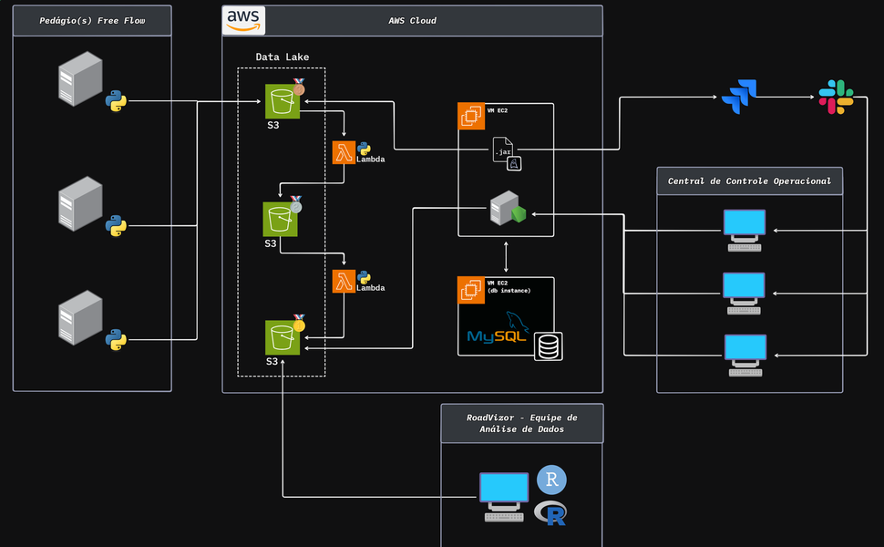
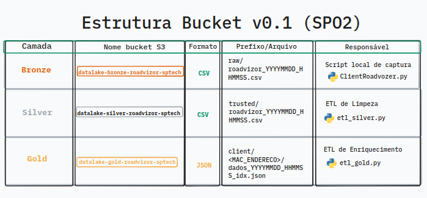

# 🛣️ RoadVizor — Monitoramento e Pipeline de Dados em Arquitetura Medallion

O **RoadVizor** é uma solução para captura, higienização, enriquecimento e análise de dados de telemetria de servidores implantados em infraestruturas rodoviárias (Servidores Free Flow). O sistema utiliza a **Arquitetura Medallion** (*Bronze, Silver e Gold*) sobre o **Amazon S3**, integrada a um banco de dados **MySQL** para gestão de inventário, regras de alerta e localização geográfica dos servidores.

---

## 📌 Visão Geral do Fluxo de Dados

```
[Servidor de Borda] ➔ consulta a [API Flask + MySQL] (quais componentes monitorar)
[Servidor de Borda] ➔ [S3 Bucket Bronze] ➔ [ETL Silver] ➔ [S3 Bucket Silver] ➔ [ETL Gold + MySQL] ➔ [S3 Bucket Gold (JSON)]
```

### 🖼️ Diagrama da Arquitetura 



---

## 🏗️ Detalhamento das Etapas da Pipeline

### 1. Coleta e Ingestão (`clientV02.py`)
Executado diretamente no servidor rodoviário (Edge Server). A captura é **dinâmica**: o client não decide sozinho o que coletar, ele pergunta à API quais componentes estão habilitados para aquela máquina.

#### 🖼️ Arquitetura da Captura

<!-- Coloque aqui a imagem da arquitetura de captura e ajuste o caminho abaixo, se necessário -->


#### 1.1 Passo a passo
1. **Identificação:** lê o endereço MAC da interface de rede (formatado sem `:` e em maiúsculas), que é o identificador único do servidor.
2. **Configuração via API:** faz `GET {ROADVIZOR_API_URL}/api/monitoramento/<mac>` e recebe a lista de componentes monitorados daquele servidor (`nome`, `depende_de`, `limite_min`, `limite_max`).
3. **Coleta autorizada:** cada `depende_de` recebido é associado a uma função fixa do dicionário `COLETORES`. O texto vindo da API **nunca é executado diretamente**; identificadores desconhecidos são ignorados e avisados no console.
4. **Tipo do dia:** classifica o dia em `DIA_UTIL`, `FIM_DE_SEMANA` ou `FERIADO` (biblioteca `holidays`, Brasil/SP).
5. **Leituras:** faz `QTD_LEITURAS` leituras (padrão 10, com 1 s de intervalo), aplicando a simulação de carga em cada uma.
6. **Geração do CSV:** monta o CSV em memória (não grava arquivo local), com separador `;`, e envia ao bucket **Bronze** com timestamp no nome: `raw/roadvizor_YYYYMMDD_HHMMSS.csv`.

#### 1.2 Coletores suportados

| Identificador (`depende_de`) | O que coleta |
|---|---|
| `psutil.cpu_percent()` | Uso global de CPU (%) |
| `psutil.virtual_memory()` | Memória RAM (total, usado, livre, %) |
| `psutil.disk_usage("/")` | Disco da partição principal |
| `psutil.swap_memory()` | Memória Swap |
| `psutil.net_if_stats()` | Status e velocidade das interfaces de rede |
| `psutil.net_io_counters()` | Bytes e pacotes enviados/recebidos |
| `psutil.disk_io_counters()` | Leitura e escrita em disco |

> Para suportar um novo componente: cadastre-o no banco com o `depende_de` correspondente **e** adicione a função em `COLETORES`.

#### 1.3 Simulação de carga (regra de negócio Free Flow)
Com `SIMULAR_VALORES = True`, o client eleva os valores de **CPU, RAM, disco e swap** conforme o tipo do dia (feriado > fim de semana > dia útil). A cada leitura sorteia-se um alvo dentro do intervalo; se o valor real for maior, o real é mantido (a simulação **nunca diminui** o uso). Rede e I/O de disco não são alterados.

| Tipo de dia | CPU | RAM | Disco | Swap |
|---|---|---|---|---|
| Dia útil | 50–60% | 50–60% | 40–50% | 20–30% |
| Fim de semana | 65–80% | 60–75% | 50–60% | 30–45% |
| Feriado | 85–99% | 80–95% | 60–75% | 50–70% |

#### 1.4 Processos
O client também registra o total de processos, quantos estão em execução, o processo que mais consome CPU, o que mais consome RAM e o top 5 por CPU (coluna `processos`, em JSON).

#### 1.5 Estrutura do CSV
* **Separador:** `;` (constante `SEPARADOR_CSV` no client).
* **Colunas fixas:** `timestamp`, `mac`, `hostname`, `so_sistema`, `arquitetura`, `cpu_fisicos`, `cpu_logicos`, `tipo_dia`, `feriado`, `processos`.
* **Colunas dinâmicas:** uma (ou mais) por componente monitorado, com nome sem acento e em minúsculas. Ex.: RAM gera `ram_total`, `ram_used`, `ram_percent`.
* O cabeçalho varia conforme o que a API devolver para cada máquina.
* Os valores são gravados **brutos** (ex.: bytes). A conversão de unidades acontece na Gold.
* Os limites (`limite_min` / `limite_max`) **não** vão no CSV: o ETL Gold os busca depois no banco, pelo MAC.

#### 1.6 API de Configuração (`app.py`)
API Flask que informa ao client quais componentes monitorar. Roda em um servidor com IP fixo, consultado por todos os clients.

* **Rota:** `GET /api/monitoramento/<endereco_mac>`
* **Resposta:**
  ```json
  {
    "endereco_mac": "A1B2C3D4E5F6",
    "componentes": [
      {
        "id_servidor": 1,
        "endereco_mac": "A1B2C3D4E5F6",
        "id_componente": 1,
        "nome": "CPU",
        "depende_de": "psutil.cpu_percent()",
        "limite_max": 80.0,
        "limite_min": 0.0
      }
    ]
  }
  ```
* **Consulta:** `JOIN` entre `servidor`, `servidor_componente` e `componente`, filtrando `monitorado = 1` e o MAC informado (com parâmetro `%s`).
* **Organização:** `app.py` ➔ `routes/monitoramento.py` ➔ `services/monitoramento.py` ➔ `database/connection.py`.

---

### 2. Camada Bronze — Dados Brutos (`datalake-bronze-roadvizor-sptech`)
* **Descrição:** Armazena o histórico imutável dos arquivos CSV gerados pelos servidores em seu estado bruto.
* **Formato:** CSV com separador `;`, no prefixo `raw/`.
* **Propósito:** Garantir a rastreabilidade dos dados originais e permitir reprocessamentos futuros caso as regras de negócio mudem.

---

### 3. Camada Silver — Higienização e Validação (`etl_silver.py`)
O job ETL Silver faz o processamento dos dados brutos para garantir a qualidade analítica. Como as colunas dos componentes são dinâmicas, as validações seguem **regras genéricas** (por sufixo de coluna), sem depender de nomes fixos.
* **Etapas de Transformação:**
  * **Leitura:** Localiza automaticamente o arquivo `.csv` mais recente no prefixo `raw/` do bucket Bronze (separador `;`, MAC lido como texto).
  * **Validação de estrutura:** Confere se as colunas fixas do client estão presentes.
  * **Tipagem:** Converte `timestamp` (`AAAA-MM-DD HH:MM:SS`), padroniza `mac` e `tipo_dia` (maiúsculas) e converte para número as colunas dinâmicas numéricas.
  * **Regras de Validação e Qualidade:**
    * Remove registros com `timestamp`, `mac` ou `tipo_dia` ausentes, ou com `tipo_dia` fora de `DIA_UTIL`, `FIM_DE_SEMANA`, `FERIADO`.
    * Garante que toda coluna `*_percent` (RAM, disco, swap) e a CPU fiquem entre $0\%$ e $100\%$.
    * Garante que nenhuma métrica numérica seja negativa.
    * Garante coerência de uso ($\text{\*\_used} \le \text{\*\_total}$).
    * **Deduplicação:** Remove medições duplicadas baseadas na combinação `mac` + `timestamp`.
  * **Processos:** Abre o JSON da coluna `processos` em colunas próprias (`proc_totais`, `proc_rodando`, `proc_cpu_top_nome`, `proc_cpu_top_pct`, `proc_ram_top_nome`, `proc_ram_top_mb`, `proc_top_lista`, entre outras).
  * **Colunas derivadas:** `data`, `hora`, `dia_semana`, `fim_de_semana`, `eh_feriado` e uma faixa de uso para cada percentual (ex.: `ram_percent` ➔ `ram_faixa`: `BAIXA`, `MODERADA`, `ALTA`, `CRITICA`).
  * **Unidades:** os valores continuam **brutos** (bytes etc.); a conversão fica por conta da Gold.
* **Destino:** Salva o dataset limpo em CSV (separador `;`) no bucket **Silver** (`datalake-silver-roadvizor-sptech`), prefixo `trusted/`, com o mesmo nome do arquivo de origem.

> **Ajuste necessário:** a CPU é o único componente que chega como número simples, então sua coluna leva o nome do componente cadastrado no banco. A Silver assume `cpu`; se o nome for outro, altere `COLUNAS_PERCENTUAIS_SIMPLES` no topo do `etl_silver.py`.

---

### 4. Camada Gold — Enriquecimento e Alertas (`etl_gold.py`)
A camada Gold transforma os dados estruturados em informação de negócio orientada a eventos.
* **Enriquecimento de Contexto:**
  * Faz o cruzamento do `endereco_mac` com o banco de dados MySQL (`roadvizor`).
  * Associa informações da concessionária/empresa (`razao_social`, `cnpj`), localização exata na rodovia (`logradouro`, `km`, `sentido`, `localidade`, `uf`) e dados do equipamento (`apelido`, `modelo`).
* **Conversão de Unidades:**
  * Converte dinamicamente as métricas brutas (Bytes) para as unidades cadastradas no banco (ex: `GiB`, `MiB`, `TiB`, `%`, `Mbps`, `ms`).
* **Motor de Alertas:**
  * Avalia os limites configurados (`limite_min` e `limite_max`) para cada componente monitorado do servidor (`servidor_componente`).
  * Define a flag booleana `em_alerta: true/false` caso a medição exceda as margens operacionais.
* **Destino:** Exporta documentos estruturados em **JSON** para o bucket **Gold** (`datalake-gold-roadvizor-sptech`), estruturados por cliente: `client/{MAC}/dados_YYYYMMDD_HHMMSS_{idx}.json`.

---

## 📊 Estrutura dos Dados Produzidos (Camada Gold)

Exemplo de payload JSON gerado na camada final:

```json
{
  "id_servidor": 1,
  "endereco_mac": "A1B2C3D4E5F6",
  "apelido": "Servidor-Pedágio-KM42",
  "empresa": "Concessionária AutoEstradas Sp",
  "localizacao_km": 42.5,
  "sentido": "Capital",
  "timestamp": "2026-09-28 08:30:00",
  "metricas_monitorizadas": [
    {
      "componente": "CPU",
      "unidade_medida": "pct",
      "valor_medido": 85.4,
      "limite_min": 0.0,
      "limite_max": 80.0,
      "em_alerta": true
    },
    {
      "componente": "RAM",
      "unidade_medida": "GiB",
      "valor_medido": 12.3,
      "limite_min": null,
      "limite_max": 15.0,
      "em_alerta": false
    }
  ]
}
```

---

### 🖼️ Infraestrutura




---

## 🛠️ Pré-requisitos e Instalação

### Dependências do Python
Certifique-se de ter o Python 3.9+ instalado. As dependências estão separadas em **dois arquivos**, para que cada ambiente instale só o que precisa.

**`requirements-client.txt`** — máquinas monitoradas (Edge Servers):
```text
boto3
psutil
getmac
holidays
requests
```

**`requirements-servidor.txt`** — servidor da API e dos ETLs:
```text
flask
gunicorn
boto3
pandas
mysql-connector-python
```

```bash
# Na máquina monitorada
pip install -r requirements-client.txt

# No servidor da API / ETLs
pip install -r requirements-servidor.txt
```

### Configuração AWS e Banco de Dados
1. **Credenciais AWS:** Configure suas credenciais na máquina via AWS CLI (`aws configure`) ou variáveis de ambiente para permitir o acesso do `boto3` aos buckets S3. No client, a permissão necessária é apenas de escrita (`PutObject`) no bucket Bronze.
2. **Banco de Dados MySQL:** A API e o `etl_gold.py` esperam um banco MySQL ativo com as tabelas `servidor`, `empresa`, `endereco`, `componente` e `servidor_componente`. Os clients **não** acessam o banco: só a API.

### Configuração do Client
Variáveis no topo do `clientV02.py`:

| Variável | Padrão | Descrição |
|---|---|---|
| `ROADVIZOR_API_URL` | `http://127.0.0.1:5000` | URL/IP da API (variável de ambiente) |
| `BUCKET_NAME` | `datalake-bronze-roadvizor-sptech` | Bucket Bronze de destino |
| `AWS_REGION` | `us-east-1` | Região AWS |
| `QTD_LEITURAS` | `10` | Leituras por execução |
| `INTERVALO_LEITURAS` | `1` | Segundos entre leituras |
| `TOP_N_PROCESSOS` | `5` | Processos no ranking |
| `SEPARADOR_CSV` | `;` | Separador do CSV (deve ser o mesmo lido pela Silver) |
| `SIMULAR_VALORES` | `True` | Liga/desliga a simulação de carga |

---

## 🚀 Como Executar

1. **Subir a API de configuração (servidor com IP fixo):**
   ```bash
   python app.py
   ```
2. **Iniciar a coleta no servidor de borda** (apontando para o IP da API):
   ```bash
   export ROADVIZOR_API_URL=http://<ip-da-api>:5000
   python clientV02.py
   ```
3. **Executar o tratamento da Camada Silver:**
   ```bash
   python etl_silver.py
   ```
4. **Executar o enriquecimento e geração da Camada Gold:**
   ```bash
   python etl_gold.py
   ```

---

## ⚠️ Pendências

* **Autenticação da API:** ainda não implementada (`autenticacao.py` vazio). Hoje quem souber um MAC consegue consultar a configuração da máquina.
* **Credenciais do banco:** estão fixas em `connection.py`; mover para variáveis de ambiente (`.env`).
* **API em produção:** usar `host="0.0.0.0"`, `debug=False` (idealmente `gunicorn`) e liberar a porta 5000 no Security Group.
* **Silver com vários servidores:** a Silver processa apenas o CSV mais recente do Bronze; com várias máquinas enviando, é preciso processar todos os arquivos novos. (VAMOS SUBIR PARA O LAMBDA DEPOIS EM)
* **Gold:** será ajustada pelo squad para o novo formato de dados da Silver.