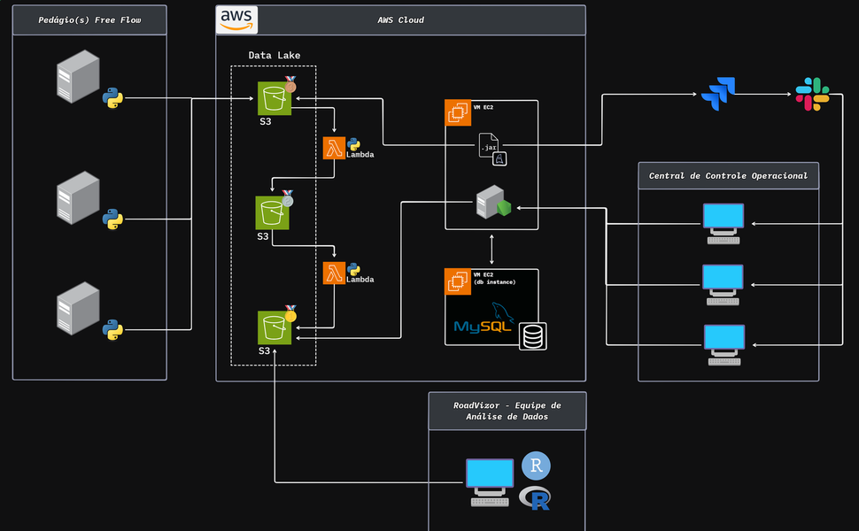
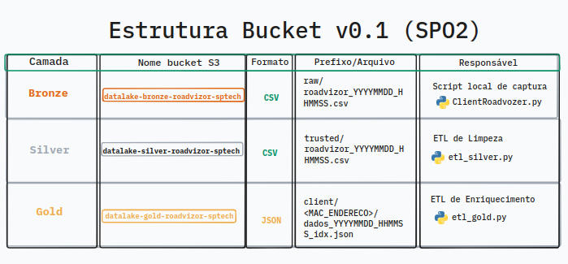

# 🛣️ RoadVizor — Monitoramento e Pipeline de Dados em Arquitetura Medallion

O **RoadVizor** é uma solução para captura, higienização, enriquecimento e análise de dados de telemetria de servidores implantados em infraestruturas rodoviárias (Servidores Free Flow). O sistema utiliza a **Arquitetura Medallion** (*Bronze, Silver e Gold*) sobre o **Amazon S3**, integrada a um banco de dados **MySQL** para gestão de inventário, regras de alerta e localização geográfica dos servidores.

---

## 📌 Visão Geral do Fluxo de Dados

```
[Servidor de Borda] ➔ [S3 Bucket Bronze] ➔ [ETL Silver] ➔ [S3 Bucket Silver] ➔ [ETL Gold + MySQL] ➔ [S3 Bucket Gold (JSON)]
```

### 🖼️ Diagrama da Arquitetura



---

## 🏗️ Detalhamento das Etapas da Pipeline

### 1. Coleta e Ingestão (`clientRoadvizor.py`)
Executado diretamente no servidor rodoviário (Edge Server).
* **Métricas Capturadas:**
  * **Identificador Único:** Endereço MAC da interface de rede (formatado sem `:`).
  * **Processamento (CPU):** Porcentagem de uso global, contagem de processos rodando e em espera.
  * **Memória:** Total e uso de RAM e Swap.
  * **Disco:** Capacidade total e uso acumulado na partição principal.
  * **Rede:** Volume de bytes enviados/recebidos, perda de pacotes e latência de rede (via `speedtest`).
* **Destino:** Salva os dados em um arquivo CSV local (`roadvizor.csv`) e realiza o upload para o bucket **Bronze** no S3 com timestamp no nome do arquivo: `raw/roadvizor_YYYYMMDD_HHMMSS.csv`.

---

### 2. Camada Bronze — Dados Brutos (`datalake-bronze-roadvizor-sptech`)
* **Descrição:** Armazena o histórico imutável dos arquivos CSV gerados pelos servidores em seu estado bruto.
* **Propósito:** Garantir a rastreabilidade dos dados originais e permitir reprocessamentos futuros caso as regras de negócio mudem.

---

### 3. Camada Silver — Higienização e Validação (`etl_silver.py`)
O job ETL Silver faz o processamento dos dados brutos para garantir a qualidade analítica.
* **Etapas de Transformação:**
  * **Leitura:** Localiza automaticamente o arquivo `.csv` mais recente no bucket Bronze.
  * **Tipagem:** Converte datas (`timestamp`) e força a conversão de métricas numéricas.
  * **Regras de Validação e Qualidade:**
    * Remove registros com `timestamp` inválido.
    * Filtra valores inconsistentes de CPU ($0\% \le \text{CPU} \le 100\%$).
    * Garante coerência de uso de RAM, Swap e Disco ($\text{uso} \le \text{total}$).
    * Garante que latência e contadores de processos não sejam negativos.
    * **Deduplicação:** Remove medições duplicadas baseadas na combinação `id_maquina` + `timestamp`.
* **Destino:** Salva o dataset limpo no formato CSV no bucket **Silver** (`datalake-silver-roadvizor-sptech`).

---

### 4. Camada Gold — Enriquecimento e Alertas (`etl_gold.py`)
A camada Gold transforma os dados estruturados em informação de negócio orientada a eventos.
* **Enriquecimento de Contexto:**
  * Faz o cruzamento do `endereco_mac` com o banco de dados MySQL (`roadvizor`).
  * Associa informações da concessionária/empresa (`razao_social`, `cnpj`), localização exata na rodovia (`logradouro`, `km`, `sentido`, `localidade`, `uf`) e dados do equipamento (`apelido`, `modelo`).
* **Conversão de Unidades:**
  * Converte dinamicamente as métricas brutas (Bytes) para as unidades cadastradas no banco (ex: `GiB`, `MiB`, `TiB`, `%`, `Mbps`, `ms`).
* **Motor de Alertas:**
  * Avalia os limites configurados (`limite_min` e `limite_max`) para cada componente monitorado do servidor (`servidor_componente`).
  * Define a flag booleana `em_alerta: true/false` caso a medição exceda as margens operacionais.
* **Destino:** Exporta documentos estruturados em **JSON** para o bucket **Gold** (`datalake-gold-roadvizor-sptech`), estruturados por cliente: `client/{MAC}/dados_YYYYMMDD_HHMMSS_{idx}.json`.

---

## 📊 Estrutura dos Dados Produzidos (Camada Gold)

Exemplo de payload JSON gerado na camada final:

```json
{
  "id_servidor": 1,
  "endereco_mac": "A1B2C3D4E5F6",
  "apelido": "Servidor-Pedágio-KM42",
  "empresa": "Concessionária AutoEstradas Sp",
  "localizacao_km": 42.5,
  "sentido": "Capital",
  "timestamp": "2026-09-28 08:30:00",
  "metricas_monitorizadas": [
    {
      "componente": "CPU",
      "unidade_medida": "pct",
      "valor_medido": 85.4,
      "limite_min": 0.0,
      "limite_max": 80.0,
      "em_alerta": true
    },
    {
      "componente": "RAM",
      "unidade_medida": "GiB",
      "valor_medido": 12.3,
      "limite_min": null,
      "limite_max": 15.0,
      "em_alerta": false
    }
  ]
}
```

---

### 🖼️ Infraestrutura




---

## 🛠️ Pré-requisitos e Instalação

### Dependências do Python
Certifique-se de ter o Python 3.9+ instalado. Instale as bibliotecas necessárias listadas no `requirements.txt`:

```bash
pip install -r requirements.txt
```

Conteúdo do `requirements.txt`:
```text
boto3
pandas
mysql-connector-python
psutil
speedtest-cli
getmac
```

### Configuração AWS e Banco de Dados
1. **Credenciais AWS:** Configure suas credenciais na máquina via AWS CLI (`aws configure`) ou variáveis de ambiente para permitir o acesso do `boto3` aos buckets S3.
2. **Banco de Dados MySQL:** O script `etl_gold.py` espera um banco MySQL ativo com as tabelas `servidor`, `empresa`, `endereco`, `componente` e `servidor_componente`.

---

## 🚀 Como Executar

1. **Iniciar a coleta local no servidor:**
   ```bash
   python clientRoadvizor.py
   ```
2. **Executar o tratamento da Camada Silver:**
   ```bash
   python etl_silver.py
   ```
3. **Executar o enriquecimento e geração da Camada Gold:**
   ```bash
   python etl_gold.py
   ```
