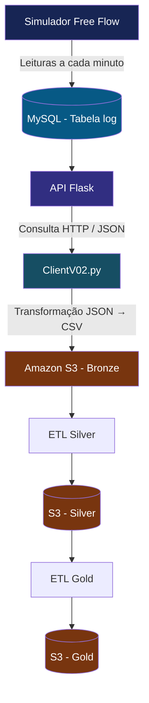

# 🚘 RoadVizor — Free Flow Services

<p align="center">
  <strong>Monitoramento inteligente de infraestrutura para operações Free Flow</strong>
</p>

<p align="center">
  
  
  
  
</p>

---

## 📖 Sobre

Este diretório reúne os serviços responsáveis pela geração, armazenamento, consulta e integração das leituras do simulador Free Flow do RoadVizor.

A arquitetura utiliza o **MySQL como fonte central dos dados**, uma API desenvolvida com Flask para disponibilizar as leituras e um cliente Python responsável pela transformação e envio dos registros ao Amazon S3.

## 🏗️ Arquitetura

O fluxo de dados funciona da seguinte maneira:



## 📂 Estrutura do projeto

```text
ClientRoadvizorV2 - Capture/
│
├── app.py
├── clientV02.py
│
├── database/
│   └── connection.py
│
├── routes/
│   └── monitoramento.py
│
└── services/
    ├── simulador_free_flow.py
    ├── monitoramento.py
    ├── venv/
    └── README.md
```

### Responsabilidades

| Arquivo | Descrição |
|---|---|
| `simulador_free_flow.py` | Gera as leituras simuladas do Free Flow e armazena no MySQL. |
| `monitoramento.py` | Consulta componentes e leituras armazenadas no banco. |
| `connection.py` | Gerencia a conexão com o MySQL. |
| `routes/monitoramento.py` | Disponibiliza os endpoints da API. |
| `app.py` | Inicializa a aplicação Flask. |
| `clientV02.py` | Consome a API, transforma os dados e envia ao S3. |

---

## 🔄 Etapas do processamento

### 1. Simulação das leituras

**Arquivo:** `simulador_free_flow.py`

O simulador representa a operação de um pedágio Free Flow e gera leituras a cada minuto.

As informações contemplam:

- CPU, RAM e disco;
- Rede e operações de I/O;
- Processos em execução;
- Quantidade de veículos e transações;
- Latência e perda de pacotes;
- Cenário operacional;
- Tipo de dia e feriados.

### 2. Armazenamento no MySQL

**Banco:** `roadvizor`  
**Tabela:** `log`

As leituras são armazenadas no campo `descricao` em formato JSON.

| Campo | Descrição |
|---|---|
| `log_id` | Identificador da leitura. |
| `servidor_id` | Servidor relacionado ao registro. |
| `titulo` | Identificação e horário da leitura. |
| `descricao` | Dados completos em JSON. |
| `status` | Situação operacional. |

### 3. Disponibilização pela API

A API Flask disponibiliza dois endpoints:

| Método | Endpoint | Finalidade |
|---|---|---|
| GET | `/api/monitoramento/<endereco_mac>` | Consulta os componentes monitorados. |
| GET | `/api/monitoramento/<endereco_mac>/leituras` | Consulta as leituras do servidor. |

**Exemplo de consulta:**

```http
GET /api/monitoramento/60FF9E5F0B3B/leituras?limite=10
```

O parâmetro `limite` controla a quantidade máxima de registros retornados.

**Exemplo simplificado de resposta:**

```json
{
  "endereco_mac": "60FF9E5F0B3B",
  "total": 1,
  "leituras": [
    {
      "log_id": 1,
      "servidor_id": 1,
      "status": "NORMAL",
      "leitura": {
        "timestamp": "2026-11-20 14:35:49",
        "tipo_dia": "FERIADO",
        "operacao": {
          "veiculos": 10,
          "transacoes": 9
        }
      }
    }
  ]
}
```

### 4. Consumo e transformação

**Arquivo:** `clientV02.py`

O cliente realiza:

1. Identificação do endereço MAC;
2. Consulta da configuração de monitoramento;
3. Requisição das últimas dez leituras;
4. Recebimento dos registros em JSON;
5. Conversão dos dados em colunas CSV;
6. Preparação do arquivo para envio ao S3.

Estruturas aninhadas são transformadas em colunas para facilitar o processamento posterior.

| Informação | Coluna CSV |
|---|---|
| CPU | `cpu` |
| RAM percentual | `ram_percent` |
| Disco percentual | `disco_percent` |
| Veículos | `operacao_veiculos` |
| Latência | `operacao_latencia_ms` |

Os dados dos processos são preservados em JSON na coluna `processos`.

### 5. Envio ao Amazon S3

O cliente utiliza `boto3` para enviar o CSV ao bucket Bronze.

**Bucket:** `datalake-bronze-roadvizor-sptech`

**Organização dos arquivos:**

```text
raw/
└── roadvizor_YYYYMMDD_HHMMSS.csv
```

Os arquivos ficam disponíveis para continuidade do processamento no ETL Silver e, posteriormente, Gold.

---

## ⚙️ Configuração e execução

Execute os comandos a partir da raiz do projeto.

### 1. Ativar o ambiente virtual

```bash
source services/venv/bin/activate
```

### 2. Instalar dependências

```bash
python3 -m pip install flask mysql-connector-python
python3 -m pip install boto3 requests psutil holidays getmac
```

### 3. Iniciar a API

```bash
python3 app.py
```

API disponível em:

```text
http://127.0.0.1:5000
```

### 4. Iniciar o simulador

Em outro terminal:

```bash
source services/venv/bin/activate
python3 services/simulador_free_flow.py
```

### 5. Executar o cliente

Em um terceiro terminal:

```bash
source services/venv/bin/activate
python3 clientV02.py
```

---

## 🧪 Testes da API

**Consultar componentes:**

```bash
curl "http://127.0.0.1:5000/api/monitoramento/60FF9E5F0B3B"
```

**Consultar as últimas dez leituras:**

```bash
curl "http://127.0.0.1:5000/api/monitoramento/60FF9E5F0B3B/leituras?limite=10"
```

---

## 🧰 Tecnologias

| Tecnologia | Utilização |
|---|---|
| Python | Desenvolvimento dos serviços |
| Flask | API REST |
| MySQL | Armazenamento das leituras |
| psutil | Métricas do sistema |
| Requests | Comunicação HTTP |
| Boto3 | Integração com AWS |
| Holidays | Identificação de feriados |
| Getmac | Identificação do MAC |
| Amazon S3 | Armazenamento dos dados |

---

## ⚠️ Observações

- O MySQL é a fonte central das leituras.
- O cliente não acessa o banco diretamente.
- O simulador gera uma leitura por minuto.
- O cliente consulta até dez registros por execução.
- A frequência de execução do cliente é independente da frequência do simulador.
- O envio ao S3 depende de credenciais AWS válidas e permissões no bucket.
- O formato CSV deve permanecer compatível com o contrato de dados do ETL Silver.

---

<<<<<<< HEAD:scripts-prj/ClientRoadvizorV2 - Capture/services/readme.md
## 🎯 Resultado da atualização

A atualização separa as responsabilidades de geração, armazenamento, consulta e envio dos dados.

**O novo fluxo permite:**

- Centralizar as leituras no MySQL;
- Evitar uma segunda coleta de métricas pelo cliente;
- Disponibilizar os registros por meio da API;
- Transformar os dados em CSV padronizado;
- Integrar o monitoramento ao Data Lake do RoadVizor.

**RoadVizor — Monitoramento inteligente para operações Free Flow.**

=======
<p align="center">
  <strong>RoadVizor</strong><br/>
  Monitoramento inteligente para operações Free Flow 🚘
</p>
>>>>>>> 98c1ff2ca50ec52ab9e0329a95a201105e334495:scripts-prj/ClientRoadvizorV2 - Capture/services/README
